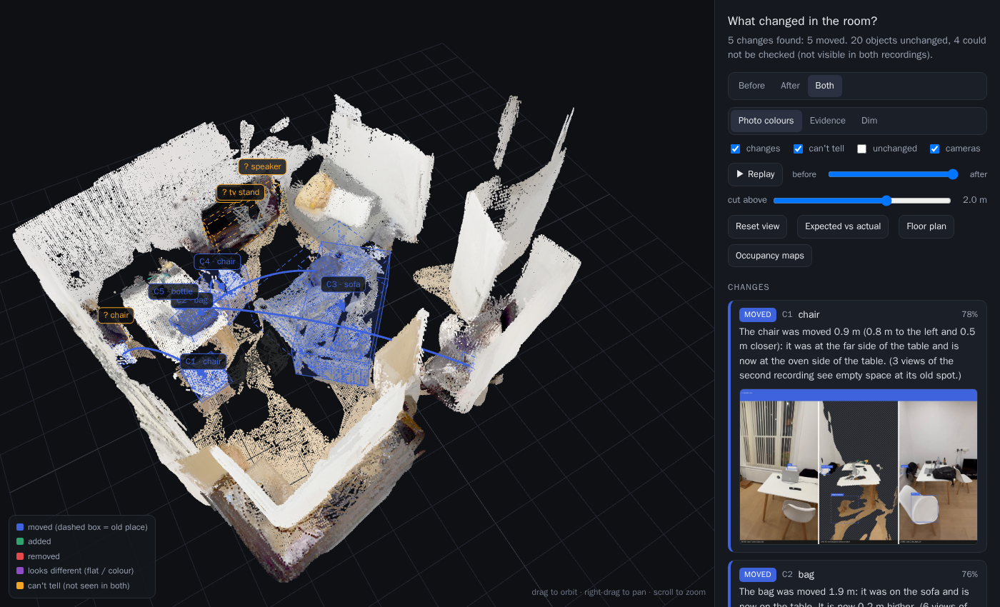
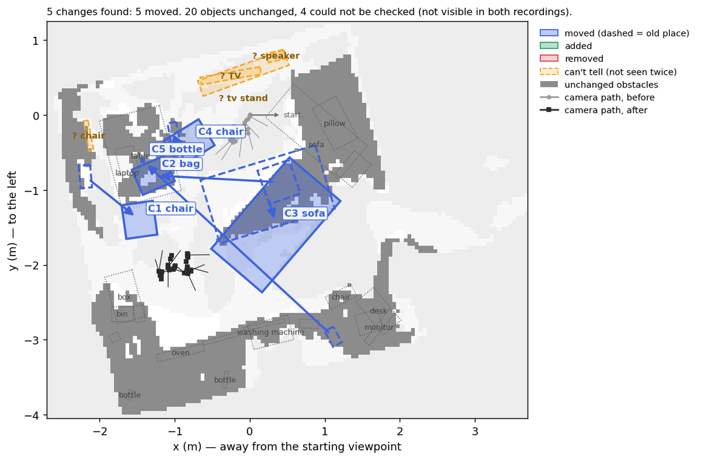
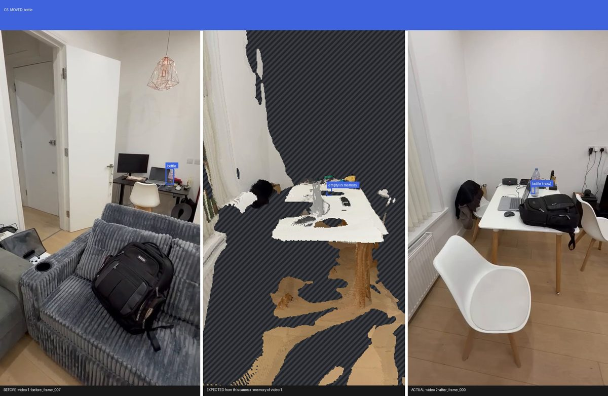
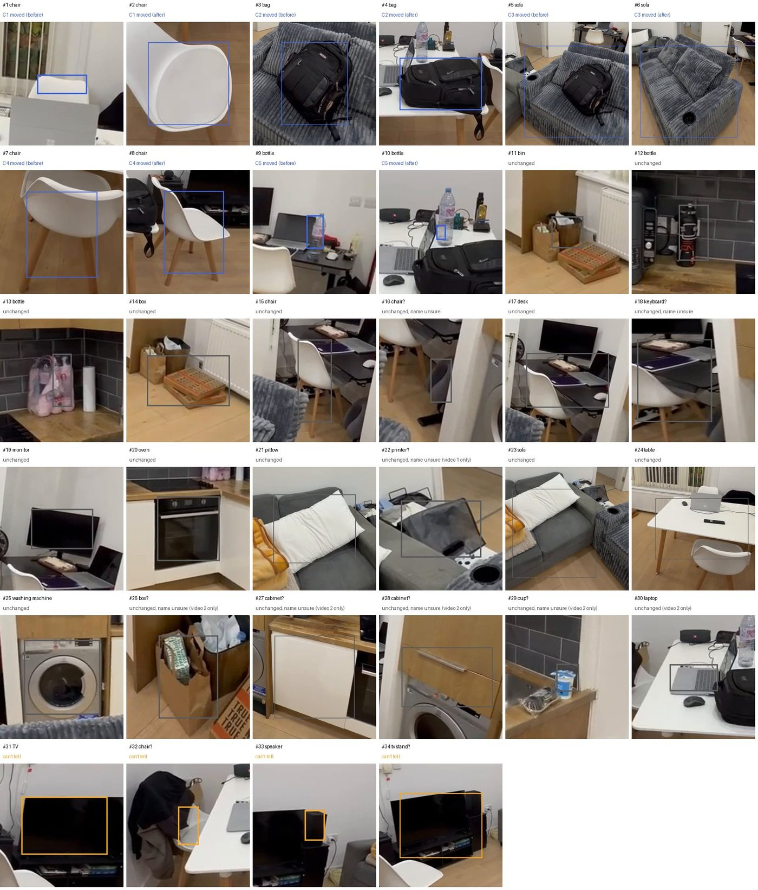
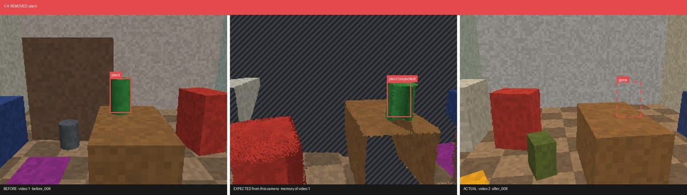
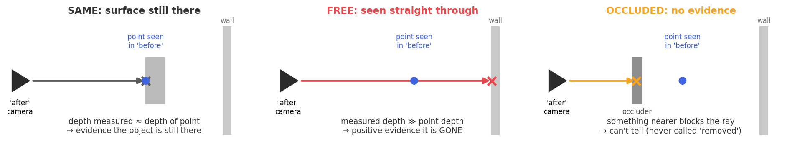

# roomdiff

This repository contains the code to compare two phone videos of the same room and find what changed in 3D:

a) furniture that was **moved**, objects that were **added** or **removed**, and flat things (a rug, papers) that changed **only in colour**;
b) **where** each change is, in one shared, gravity-aligned 3D frame in metres;
c) **what** each change is, as a label and a sentence built from the measured geometry.

Places that only one of the videos saw are reported as **can't tell**, not as changes.

Developed for the Humanoid intern challenge *What Changed in the Room?* (2026).

[](https://amirhebeish.github.io/roomdiff/)

*The real room: the sofa, two chairs, a backpack and a water bottle were moved between the two videos. All five are found and described, with no false changes. [Open the live 3D viewer](https://amirhebeish.github.io/roomdiff/) (no install) or read the [full report](examples/real_room/report.md).*

## Quick start

1. **Look at a result, no install:** the [live 3D viewer](https://amirhebeish.github.io/roomdiff/) of the real room, or the [synthetic one](https://amirhebeish.github.io/roomdiff/synthetic.html).
2. **Run it in a minute, no GPU:** clone the repository, `pip install -e ".[dev]"`, then `python -m roomdiff demo --out runs/synthetic` (a synthetic room with ground truth, scored at the end).
3. **Run it on your own two videos:** open the [Colab notebook](https://colab.research.google.com/github/amirhebeish/roomdiff/blob/main/notebooks/roomdiff_colab.ipynb), upload `before.mp4` and `after.mp4`, run all cells (details in [Running on your own videos](#1-running-on-your-own-videos)).

## What the brief asks, and where it is

| The brief | In this repository |
|---|---|
| Shared 3D representation of the two recordings | both videos reconstructed in one pass into one gravity-aligned frame in metres ([Method](#method), steps 1-2) |
| Moved, added and removed objects, visualised in 3D | 3D viewer with old and new boxes and a before/after replay, floor plan, same-viewpoint evidence images; moves on the real room, all three kinds on the [synthetic room](#synthetic-room-with-ground-truth) |
| New obstacles | before/after occupancy maps at robot height, as ROS `map_server` files ([Outputs](#3-outputs)) |
| Semantic labels and natural language | a label and a sentence per change, built from the measured geometry: distance, from where to where, what it stands on |
| Viewpoint, occlusion, incomplete observations | each point is tested against what the other video's cameras actually saw; occluded or never filmed is **can't tell**, never "removed" ([The idea](#the-idea)) |
| Example inputs and outputs | [examples/real_room](examples/real_room/) (the two videos and every output), [examples/synthetic](examples/synthetic/) |
| Design choices and trade-offs | [Design choices and trade-offs](#design-choices-and-trade-offs) |

## The idea

Instead of subtracting two 3D scans, the first video is used as a **memory** of the room. For every frame of the second video, the memory is rendered from exactly that camera. This gives what the camera *should* see if nothing had changed, and the difference from what it *did* see is the change:

* expected and actual images share the same viewpoint, so camera motion cannot look like a change;
* a remembered surface the camera now sees straight through is **gone**, and a surface in front of the remembered one is **new**;
* where the shape is unchanged but the colour is not, **something flat** changed;
* where the memory is empty, the room was never seen, and the answer is **can't tell**.


*Left: the memory of video 1, rendered from the video 2 camera (hatched = never seen). Middle: what that camera saw. Right: the surprise (red gone, green new, purple recoloured).*

The thresholds are not hand tuned. Each video is compared with itself (even frames against odd frames, where nothing changed) to measure the depth noise of the run, and the tolerance is set from that measurement. The same split doubles as a **self-test** that reports the false alarm rate of the run.

## Results

### A real room

Two portrait phone videos of a flat, about 30 s each ([inputs](examples/real_room/input/), [full report](examples/real_room/report.md)). Between them the sofa, two chairs, a backpack and a water bottle were moved. Nothing else was touched.

[Interactive 3D viewer of this run](https://amirhebeish.github.io/roomdiff/): before/after/both, a replay slider that animates every change, per-point evidence colours, and the expected-vs-actual gallery.

| What was moved | What roomdiff reported |
|---|---|
| the sofa | *"The sofa was moved 0.4 m [...] It was also turned about 32°."* |
| a chair | *"The chair was moved 0.9 m [...] it was at the far side of the table and is now at the oven side of the table."* |
| another chair | *"The chair was turned about 69° and shifted 0.3 m; it is still on the floor, at the sofa side of the table."* |
| the backpack | *"The bag was moved 1.9 m: it was on the sofa and is now on the table."* |
| the water bottle, desk to table | *"The bottle was moved 3.5 m: it was on the desk and is now on the table."* |
| nothing else | 0 false changes; 20 objects unchanged, and 4 things only one video saw (the TV and its stand, a speaker, a chair behind the table) listed as can't tell |

Two checks where the right answer is "nothing changed": each video split into even and odd frames and run through the whole pipeline gives **0 changes** for both videos, and the point-level self-test flags 0.24 % of points.



The water bottle is clear plastic, so depth sees straight through it to the wall behind, and the free-space test can't notice it went. For small objects like this the detector gets a second opinion, in both directions. The first video finds the bottle on the desk in all 6 frames that look there, and the second video finds nothing there in 4 clear looks. The second video finds a bottle on the table in all 5 of its frames, and the first video finds nothing there in 6 clear looks. The report says the evidence comes from the detector, and the confidence stays at 56 %:



> *The bottle was moved 3.5 m: it was on the desk and is now on the table. Depth sees straight through it, so the detector checked instead: the second video looked at the old spot from 4 viewpoints and never found it there, and the first video looked at the new spot from 6 viewpoints and never found it there either.*

Everything it found, change or not, is listed in the report with where it is, and shown in one photo sheet: 29 things across the two videos (the five that moved appear twice, before and after), from the sofas down to the washing machine, the oven and the milk carton. A name followed by "?" is one it isn't sure of:



The sofa's move is measured twice, independently: the centres of its two footprints give 0.4 m and 32°, and fitting its shape from one video into the other gives 0.4 m and 31°.


What the real videos taught (each of these is now handled in the code and was found through the run's own diagnostics, not by looking at the answer):

* **Portrait video:** on portrait frames VGGT returned focal lengths 1.8x apart in x and y. The self-test flagged 5 % of points of a video compared with itself, which gave it away; the frames are now padded to a square, and the self-test dropped to 0.24 %.
* **The phone is not level:** the floor search started from the phones' "up", which is a few degrees off when people film, and it locked onto a surface above the floor, tilted 20°. The room came out sloping and too big. Up now comes from the room itself (walls, floor and table tops vote), the floor is the lowest well-supported plane along it, and heights and the metric scale are right again (table top 0.72 m).
* **Door and cabinet edges:** surfaces seen edge-on give the least reliable depth, and showed up as thin unnamed "changes". An unnamed change now has to look like a thing (at least 6 cm thick and not a long sliver).
* **Names that don't fit:** the corduroy sofa was called "chair" about as often as "sofa"; when votes are close, the name that fits the measured size wins (a 1.6 m chair is a sofa). A table with a monitor on it is called a desk, and a screen wider than 70 cm a TV. A "keyboard" as square as a laptop is the laptop. And a name backed by only one or two weak detections, or by a size that doesn't fit it (a milk carton taken for a "cup", a 25 cm "chair"), is no longer stated as fact: it gets a "?", while the object itself is still checked for changes.
* **Left and right behind the camera:** directions were first given along the first camera's axes, so for the table, which is behind where the first video started, "near" and "far" came out swapped. Sides and directions are now taken as seen from the start looking at the object, a side is named by the furniture it faces where it can be ("the sofa side of the table"), and long moves are described by their old and new places only.
* **More words made it worse:** adding kitchen appliances and small electronics to the detector's word list lost the backpack and two chairs, because Grounding DINO splits its confidence between similar words in one prompt. The extra words now run as a second pass that only fills gaps the main list left, so the washing machine and the oven are found and nothing that was found before is lost.

### Synthetic room with ground truth

`python -m roomdiff demo`: a 6 x 5 m room filmed twice from opposite sides. The test adds depth noise, per-frame scale jitter, a before/after misalignment, an exposure change between the videos, an arbitrary global frame and scale, and a detector that misses ~15 % of objects and gets one label wrong.

| Ground truth | Result |
|---|---|
| chair moved 1.8 m and turned 60 deg | moved, position within 15 cm, rotation 60 deg |
| plant taken off the table | removed |
| backpack put on the floor | added |
| toy box, not in the detector vocabulary | added, as unidentified object |
| 4 mm rug removed, invisible to geometry | looks different, correctly called removed |
| lamp in a corner the 2nd video never films | can't tell (out of view) |
| bin behind a shelf in every 2nd video frame | can't tell (occluded) |
| sofa, table, cabinet, shelf, seen from opposite sides | unchanged |
| false positives | 0, and 0 on two runs where nothing changed |

The measured depth noise was 1.4 % (the simulator injects ~1.3 %), and the self-test flagged 0 % of points.

Every change comes with the original photo, plus the expected and actual view from the same camera ([full report](examples/synthetic/report.md), [3D viewer](https://amirhebeish.github.io/roomdiff/synthetic.html)):



> *The plant (about 26 x 20 x 40 cm) that was on the table has been removed. The second recording looked at that spot from 12 viewpoints and saw straight through to the surface behind.*

## Repository structure

* [roomdiff](./roomdiff/): the package (one module per stage, listed under *Method*);
* [notebooks](./notebooks/): the Colab notebook to run on your own videos;
* [tests](./tests/): geometry checks, the synthetic benchmark and the video-path test;
* [examples/real_room](./examples/real_room/): the two real videos and every output of their run;
* [examples/synthetic](./examples/synthetic/): the outputs of the synthetic run;
* [docs](./docs/): capture guide, README images and the live viewer;
* [viewer](./viewer/): source of the 3D viewer (three.js, bundled into `roomdiff/viz/viewer_bundle.js`).

## 1. Running on your own videos

Filming: a slow 20–40 s walk (portrait or landscape) with the floor in view, and the second video from different spots. See [docs/CAPTURE_GUIDE.md](docs/CAPTURE_GUIDE.md).

On Colab (free GPU):
1. open [notebooks/roomdiff_colab.ipynb](https://colab.research.google.com/github/amirhebeish/roomdiff/blob/main/notebooks/roomdiff_colab.ipynb) and choose a T4 GPU runtime;
2. run the cells: they install, ask for `before.mp4` and `after.mp4`, run the pipeline, show the results and zip them.

Locally (NVIDIA GPU):
```
git clone https://github.com/amirhebeish/roomdiff && cd roomdiff
git clone --depth 1 https://github.com/facebookresearch/vggt third_party/vggt
pip install -e ".[models]"
python -m roomdiff run --before before.mp4 --after after.mp4 --out runs/my_room
```
The reconstruction and detections are cached, so the reasoning can be re-run on CPU with other settings: `python -m roomdiff analyze --out runs/my_room`.

Options:

| Option | Meaning | Default |
|---|---|---|
| `--frames` | keyframes per video | 24 |
| `--camera-height` | phone height above the floor while filming [m], sets the scale | 1.4 |
| `--extra-classes` | classes added to the detector's second pass, comma separated | none |
| `--classes` | replaces the detector vocabulary | ~50 indoor classes |
| `--tau` | minimum depth tolerance [m] | 0.06 |
| `--no-reuse` | ignore the cached reconstruction and detections | off |

## 2. Synthetic benchmark

Needs no GPU or model download:
```
pip install -e ".[dev]"
python -m roomdiff demo --out runs/synthetic
pytest
```
`demo` prints the scorecard against the ground truth (under a minute). `pytest` runs the geometry checks, the benchmark on two seeds, a run where nothing changed, and the full video path with VGGT replaced by ground truth (about 3 min).

## 3. Outputs

Each run writes to `runs/<name>/`:
* `viewer.html`: the 3D viewer, one self-contained file that also works offline;
* `report.md`: one paragraph and one evidence image per change, the can't tell list, everything it found (table and photo sheet) and the diagnostics;
* `changes.json`: type, label, confidence, 3D boxes in metres, displacement and rotation, and the evidence counts behind every claim;
* `figures/`: floor plan, evidence images, expected-vs-actual frames and gif;
* `maps/`: before/after occupancy at robot height as ROS `map_server` files (`.pgm` + `.yaml`), plus the change layer;
* `pointclouds/`: both videos as coloured `.ply` in the shared frame.

## Method

1. **Keyframes** (`frames.py`): the sharpest frame in each of 24 equal time bins of each video.
2. **One shared scene** (`reconstruct.py`, `align.py`): the keyframes of both videos go through [VGGT](https://github.com/facebookresearch/vggt) in a single forward pass, so all cameras come out in one frame and no separate registration is needed. Up comes from the room's own surfaces (floor, ceiling and table tops face up, walls run along it), RANSAC finds the floor (z = 0), the median phone height sets metres, and a damped point-to-plane ICP refines the before/after alignment. The ICP is only kept if it improves the surface agreement.
3. **Calibration** (`calibrate.py`): the depth noise is measured inside each video (even vs odd frames) and the tolerance is set to 3.5 sigma, then the same split is run as a self-test.
4. **Per ray test** (`visibility.py`): every 3D point of one video is projected into every camera of the other, and the measured depth D is compared with the point's depth z. Same depth means the point is still there, D beyond z means the camera saw through it and it is gone, and D in front of z means it is occluded, so there is no evidence. A change needs at least 2 see-through views. The tolerance grows at grazing angles, and a 3x3 depth window keeps edges from voting.

   

5. **Expected view** (`expect.py`): the memory is splatted with a z-buffer into each camera of the second video. This produces the gif and the same-viewpoint evidence images, coloured with the verdicts from step 4, so the pictures and the report always agree.
6. **Colour** (`appearance.py`): on surfaces step 4 confirmed unchanged, one global colour map removes the exposure difference, then the colours are compared with chroma weighted over brightness, because shadows change brightness and objects change colour. Colour changes near a geometric change (shadows) or explained by a neighbouring voxel (misalignment) are ignored.
7. **Objects** (`detect.py`, `objects.py`, `changes.py`): Grounding DINO boxes (a main list of ~50 indoor names, then a second pass of ~30 everyday things that only fills gaps), SAM masks and CLIP embeddings are lifted to 3D and fused across views. Gone and new objects are matched (Hungarian algorithm on label, look and size) into moves. The move is then measured by fitting the better seen copy's shape into the other video's point cloud (a turn and a shift on the floor, coarse search then ICP), and following its footprint centre. If the fit is poor, it falls back to the footprint centres, because the two videos often see opposite faces. A turn is only reported when the shape fit and the footprint's long axis agree on it. A same-label object on the same footprint is the same object seen from another side, unless its own evidence is overwhelming, in which case it was pushed or turned in place. When the detector hesitates between two names, the one that fits the measured size wins. Changed geometry with no detection is an unidentified object, as long as it is shaped like one.
8. **Second opinion** (`recheck.py`): for small objects that depth can't see (glass, clear plastic), every frame of the other video that clearly looks at the spot is asked whether the detector still finds the object there, under any name it was often given (a laptop is sometimes a "keyboard"). It only counts when the detector is reliable on that object in its own video. Glass often has no depth at all; a view still counts as clear if nothing measured near that pixel is in front of the spot.
9. **Words** (`describe.py`): each sentence is filled in from measured quantities (distance, direction as seen from where the first video started, what it stands on, nearest unchanged landmark, size, number of confirming views), and says which kind of evidence it rests on.

## Design choices and trade-offs

* **Memory and prediction instead of scan differencing:** viewpoint and occlusion are handled by construction, colour comes for free, and every claim can be shown as a picture. A robot could run the same loop with its own depth and poses instead of VGGT.
* **Joint feed-forward reconstruction instead of COLMAP and registration:** it is fast, needs no calibration, and both videos share one frame. The cost is learned depth with a few percent of error, which the measured tolerance and multi-view voting absorb.
* **Geometry decides whether something changed, semantics names it:** a missed or wrong detection can't create or hide a change. The one exception is small see-through objects, where geometry is blind; there the detector gets a vote, only with several clear looks, and the report says so and lowers the confidence.
* **Can't tell is an answer:** knowing what hasn't been verified is as useful to a robot as knowing what changed.
* **Scale from a phone-height prior:** simple, but distances can be off by up to ~15 % unless `--camera-height` is given.

Limitations: people walking through the shot count as changes; objects under ~10 cm give too little signal; thin things (a broom, a door left at a different angle) are dropped on purpose because their depth is unreliable; when an object was only glimpsed in one video (a chair hidden behind a laptop), its shape can't be fitted and the move is measured between partial footprints, good to a few tens of cm; a large lighting change can trigger colour changes; and the two videos need a good part of the room in common.

## Built on

* [VGGT](https://github.com/facebookresearch/vggt), Meta: joint reconstruction (the original checkpoint is non-commercial, and a commercial checkpoint exists);
* [Grounding DINO](https://github.com/IDEA-Research/GroundingDINO), [SAM](https://github.com/facebookresearch/segment-anything) and [CLIP](https://github.com/openai/CLIP) through Hugging Face `transformers`;
* [three.js](https://threejs.org) for the viewer.
