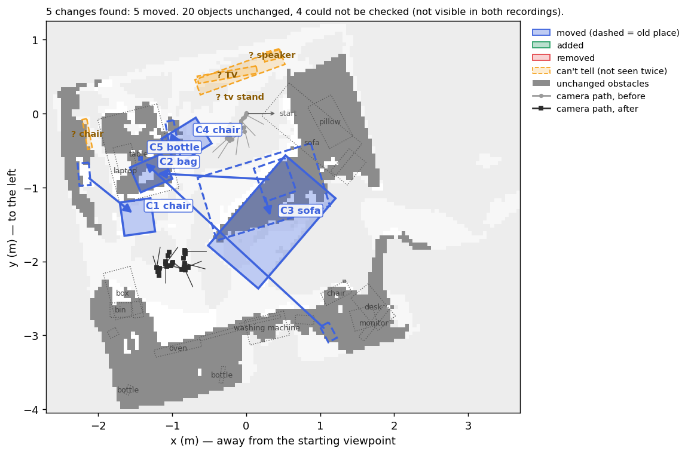
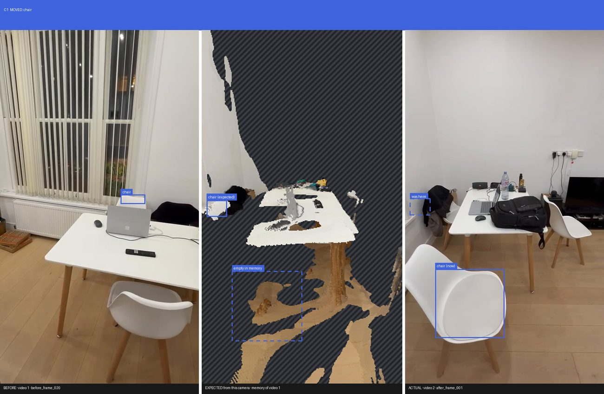
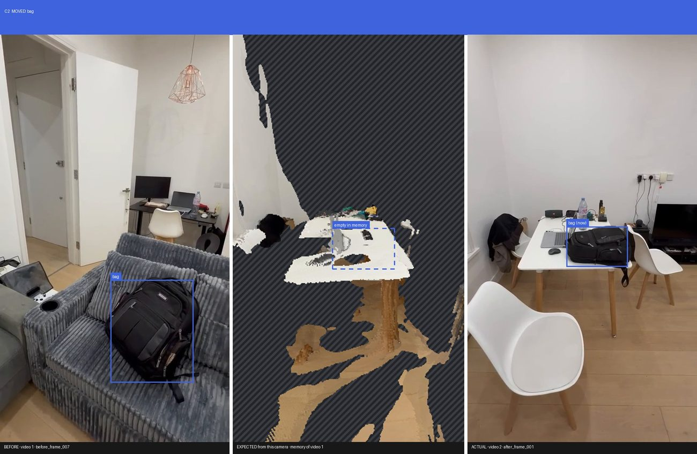
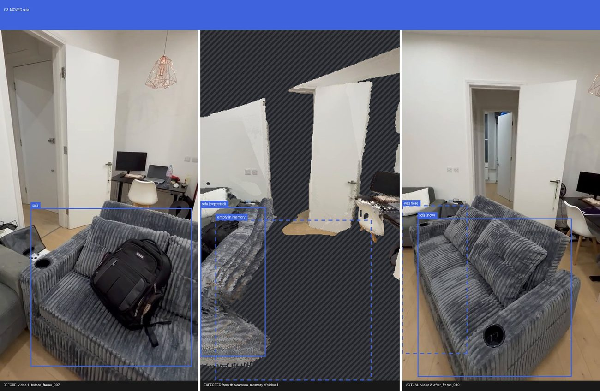
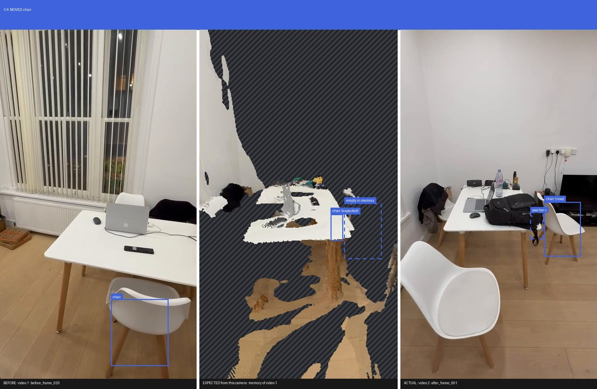
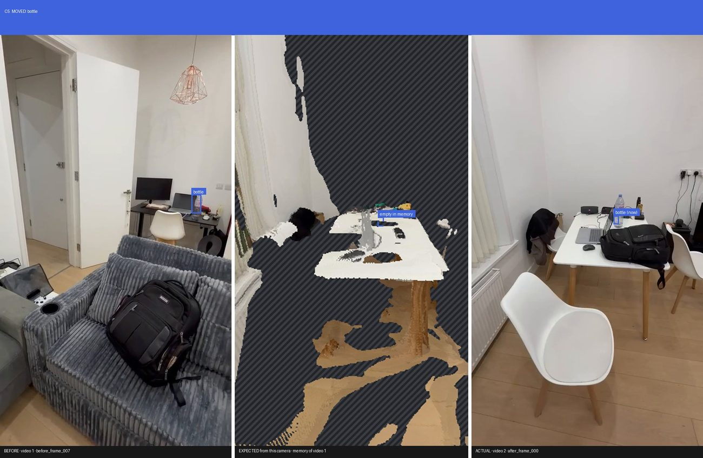
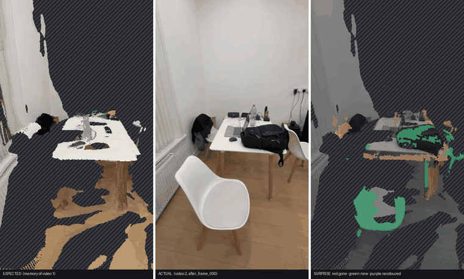
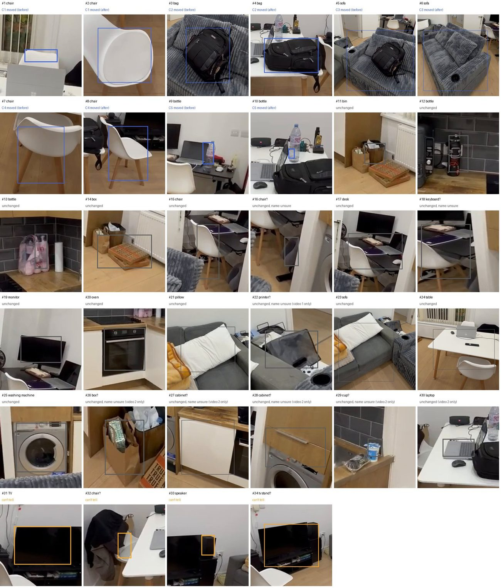
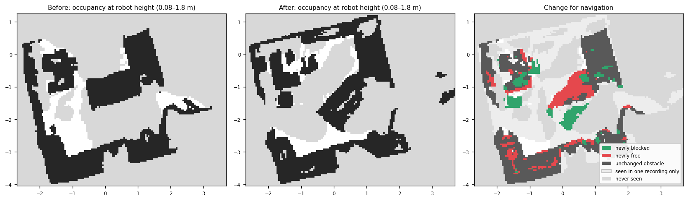

# What changed in the room?

**5 changes found: 5 moved. 20 objects unchanged, 4 could not be checked (not visible in both recordings).**

## Changes

### C1 · moved · chair  (confidence 78%)

The chair was moved 0.9 m (0.8 m to the left and 0.5 m closer): it was at the far side of the table and is now at the oven side of the table. (3 views of the second recording see empty space at its old spot.)

### C2 · moved · bag  (confidence 76%)

The bag was moved 1.9 m: it was on the sofa and is now on the table. It is now 0.2 m higher. (6 views of the second recording see empty space at its old spot.)

### C3 · moved · sofa  (confidence 73%)

The sofa was moved 0.4 m (0.4 m further away): it was 0.7 m right of the other sofa and is now 1.0 m right of the other sofa. It was also turned about 32°. (8 views of the second recording see empty space at its old spot.)

### C4 · moved · chair  (confidence 72%)

The chair was turned about 69° and shifted 0.3 m; it is still on the floor, at the sofa side of the table. (8 views of the first recording saw empty space at its new spot.)

### C5 · moved · bottle  (confidence 56%)

The bottle was moved 3.5 m: it was on the desk and is now on the table. Depth sees straight through it, so the detector checked instead: the second video looked at the old spot from 4 viewpoints and never found it there, and the first video looked at the new spot from 6 viewpoints and never found it there either.

## Can't tell

- Can't tell: the TV 0.9 m in front of the sofa (seen in the second recording) is not reported as changed, because it was never in view during the first recording.
- Can't tell: the object that looks like a chair next to the table (seen in the second recording) is not reported as changed, because other things blocked the view of it in every frame of the first recording.
- Can't tell: the speaker next to the sofa (seen in the second recording) is not reported as changed, because it was never in view during the first recording.
- Can't tell: the object that looks like a tv stand on the floor, 0.8 m in front of the sofa (seen in the second recording) is not reported as changed, because it was never in view during the first recording.

## Expected vs actual

For every camera of the second video: what the first video predicts it should see, what it saw, and the surprise (red = gone, green = new, purple = recoloured, hatched = never seen before).

## Everything it found

Every object the run found, numbered as in the photo sheet. A name with "?" rests on one or two weak detections; the object is still checked for changes.

| # | object | status | where | size |
|---|---|---|---|---|
| 1 | chair | C1 moved (before) | next to the table | 30 x 15 x 8 cm |
| 2 | chair | C1 moved (after) | next to the table | 45 x 42 x 9 cm |
| 3 | bag | C2 moved (before) | on the sofa | 47 x 44 x 32 cm |
| 4 | bag | C2 moved (after) | on the table | 46 x 37 x 16 cm |
| 5 | sofa | C3 moved (before) | 0.7 m right of the other sofa | 160 x 89 x 64 cm |
| 6 | sofa | C3 moved (after) | 1.0 m right of the other sofa | 161 x 89 x 60 cm |
| 7 | chair | C4 moved (before) | on the floor, next to the table | 48 x 12 x 43 cm |
| 8 | chair | C4 moved (after) | on the floor, next to the table | 54 x 41 x 63 cm |
| 9 | bottle | C5 moved (before) | on the desk | 24 x 13 x 22 cm |
| 10 | bottle | C5 moved (after) | on the table | 4 x 3 x 5 cm |
| 11 | bin | unchanged | on the floor, 0.7 m right of the oven | 29 x 20 x 18 cm |
| 12 | bottle | unchanged | next to the oven | 19 x 15 x 23 cm |
| 13 | bottle | unchanged | 0.6 m beyond the oven | 17 x 10 x 28 cm |
| 14 | box | unchanged | on the floor, next to the bin | 65 x 38 x 18 cm |
| 15 | chair | unchanged | next to the desk | 38 x 19 x 58 cm |
| 16 | chair? | unchanged, name unsure | next to the desk | 25 x 10 x 20 cm |
| 17 | desk | unchanged | next to the chair | 114 x 67 x 23 cm |
| 18 | keyboard? | unchanged, name unsure | next to the desk | 98 x 43 x 40 cm |
| 19 | monitor | unchanged | on the desk | 52 x 11 x 27 cm |
| 20 | oven | unchanged | 0.7 m right of the bottle | 64 x 10 x 50 cm |
| 21 | pillow | unchanged | on the sofa | 63 x 36 x 28 cm |
| 22 | printer? | unchanged, name unsure (video 1 only) | next to the sofa | 40 x 29 x 21 cm |
| 23 | sofa | unchanged | next to the pillow | 128 x 58 x 42 cm |
| 24 | table | unchanged | next to the laptop | 118 x 83 x 52 cm |
| 25 | washing machine | unchanged | next to the desk | 55 x 34 x 50 cm |
| 26 | box? | unchanged, name unsure (video 2 only) | on the floor, next to the bin | 22 x 14 x 18 cm |
| 27 | cabinet? | unchanged, name unsure (video 2 only) | next to the oven | 58 x 5 x 61 cm |
| 28 | cabinet? | unchanged, name unsure (video 2 only) | next to the desk | 56 x 4 x 16 cm |
| 29 | cup? | unchanged, name unsure (video 2 only) | next to the bin | 12 x 10 x 7 cm |
| 30 | laptop | unchanged (video 2 only) | on the table | 35 x 25 x 5 cm |
| 31 | TV | can't tell | 0.9 m in front of the sofa | 81 x 10 x 44 cm |
| 32 | chair? | can't tell | next to the table | 41 x 6 x 8 cm |
| 33 | speaker | can't tell | next to the sofa | 23 x 12 x 26 cm |
| 34 | tv stand? | can't tell | on the floor, 0.8 m in front of the sofa | 122 x 22 x 60 cm |

## Unchanged

bin, bottle, box, chair, desk, laptop, monitor, oven, pillow, sofa, table, washing machine

## Navigation view

ROS map_server files: `maps/map_before.yaml`, `maps/map_after.yaml`.

## Diagnostics

- Floor plane found; metric scale from an assumed 1.40 m phone height.
- Up taken from the room itself (walls, floor, table tops: 46% of surfaces agree); the phone's own tilt was 8° off.
- Before/after registration refinement applied (surface agreement 20% → 29%).
- Measured depth noise 1.6% of distance (each video against itself), so the depth tolerance is 5.4%.
- Self-test, video 1 against itself where nothing changed: 0.24% of 146548 points falsely flagged.
- 54% of the 'after' surface lies on 'before' surface.
- 'before' points judged by the other video: kept 60%, changed 4%, ambiguous 2%, hidden 17%, unseen 17%
- 'after' points judged by the other video: kept 56%, changed 2%, ambiguous 1%, hidden 16%, unseen 26%
