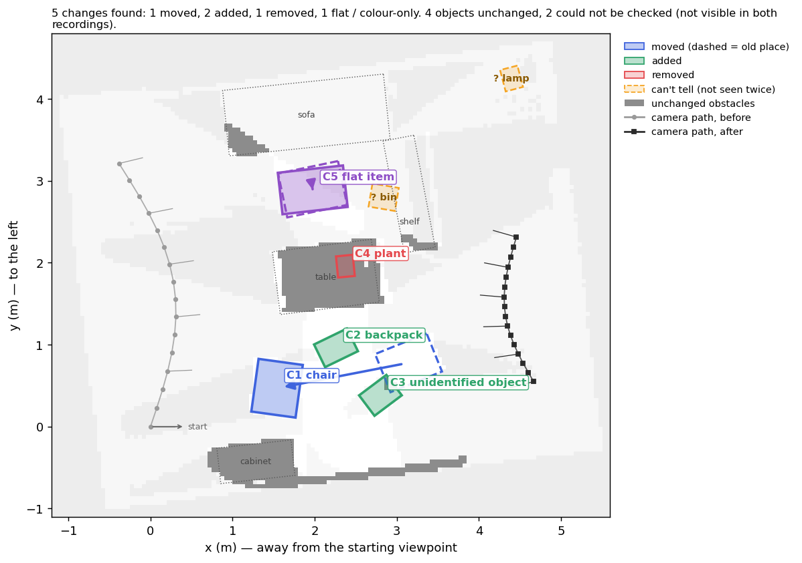
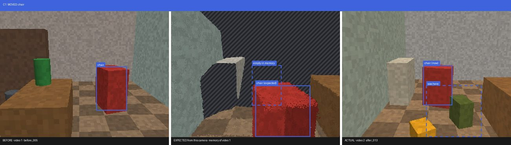
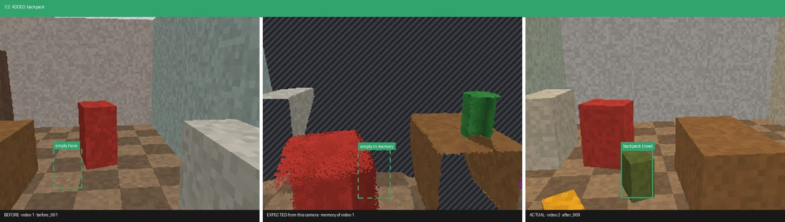
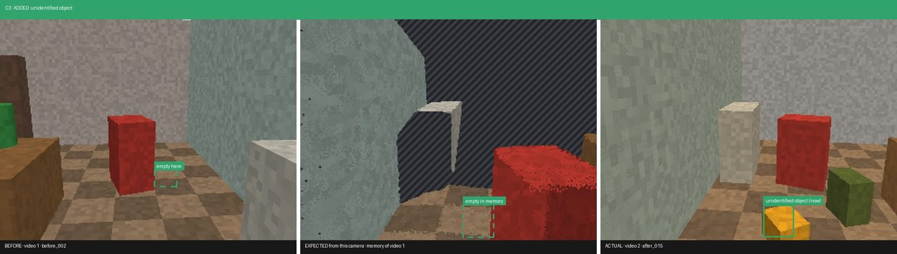
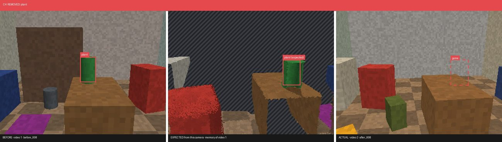
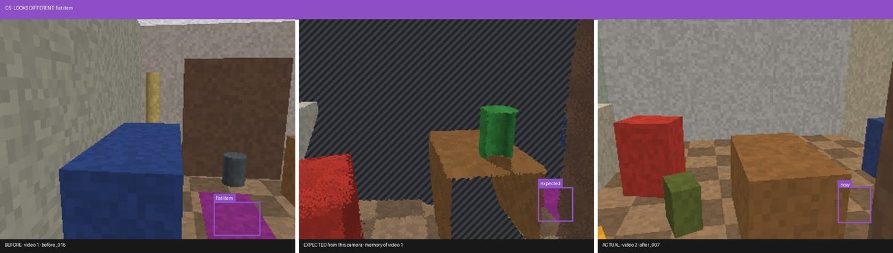
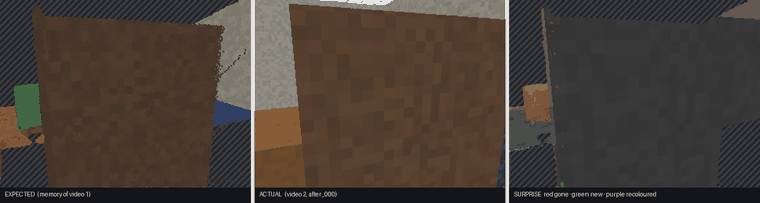
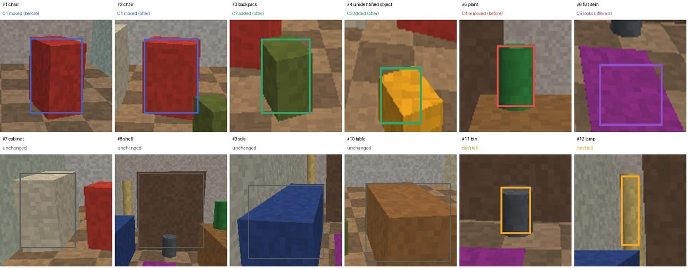
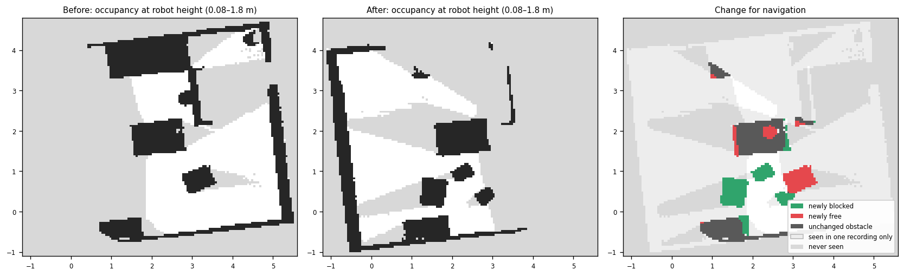

# Synthetic room · what changed?

**5 changes found: 1 moved, 2 added, 1 removed, 1 flat / colour-only. 4 objects unchanged, 2 could not be checked (not visible in both recordings).**

## Changes

### C1 · moved · chair  (confidence 95%)

The chair was moved 1.6 m: it was on the floor, 0.7 m right of the table and is now on the floor, 0.6 m left of the cabinet. It was also turned about 60°. (10 views of the second recording see empty space at its old spot.)

### C2 · added · backpack  (confidence 87%)

New: a backpack (about 44 x 31 x 44 cm) appeared on the floor, next to the table. The first recording saw empty space there from 10 viewpoints.

### C3 · added · unidentified object  (confidence 80%)

New: an unidentified object (about 42 x 31 x 12 cm) appeared on the floor, 1.0 m right of the table. The first recording saw empty space there from 8 viewpoints.

### C4 · removed · plant  (confidence 92%)

The plant (about 26 x 20 x 40 cm) that was on the table has been removed. The second recording looked at that spot from 12 viewpoints and saw straight through to the surface behind.

### C5 · appearance · flat item  (confidence 85%)

Something flat (a rug, mat, papers...) was removed from the floor, next to the sofa (about 74 x 55 cm). The 3D shape there is unchanged, so only the colour gives it away: the second video now sees the same colour as the surroundings.

## Can't tell

- Can't tell: the bin on the floor, next to the shelf (seen in the first recording) is not reported as changed, because other things blocked the view of it in every frame of the second recording.
- Can't tell: the lamp 1.4 m beyond the shelf (seen in the first recording) is not reported as changed, because it was never in view during the second recording.

## Expected vs actual

For every camera of the second video: what the first video predicts it should see, what it saw, and the surprise (red = gone, green = new, purple = recoloured, hatched = never seen before).

## Everything it found

Every object the run found, numbered as in the photo sheet. A name with "?" rests on one or two weak detections; the object is still checked for changes.

| # | object | status | where | size |
|---|---|---|---|---|
| 1 | chair | C1 moved (before) | on the floor, 0.7 m right of the table | 68 x 50 x 84 cm |
| 2 | chair | C1 moved (after) | on the floor, 0.6 m left of the cabinet | 65 x 54 x 84 cm |
| 3 | backpack | C2 added (after) | on the floor, next to the table | 44 x 31 x 44 cm |
| 4 | unidentified object | C3 added (after) | on the floor, 1.0 m right of the table | 42 x 31 x 12 cm |
| 5 | plant | C4 removed (before) | on the table | 26 x 20 x 40 cm |
| 6 | flat item | C5 looks different | on the floor, next to the sofa | 74 x 55 x 5 cm |
| 7 | cabinet | unchanged | on the floor, 1.9 m in front of the table | 105 x 47 x 94 cm |
| 8 | shelf | unchanged | on the floor, 0.6 m right of the sofa | 139 x 38 x 152 cm |
| 9 | sofa | unchanged | on the floor, 1.1 m left of the shelf | 197 x 80 x 71 cm |
| 10 | table | unchanged | on the floor, 0.8 m in front of the shelf | 124 x 77 x 65 cm |
| 11 | bin | can't tell | on the floor, next to the shelf | 33 x 29 x 37 cm |
| 12 | lamp | can't tell | 1.4 m beyond the shelf | 27 x 22 x 95 cm |

## Unchanged

cabinet, shelf, sofa, table

## Navigation view

ROS map_server files: `maps/map_before.yaml`, `maps/map_after.yaml`.

## Diagnostics

- Floor plane found; metric scale from an assumed 1.40 m phone height.
- Up taken from the room itself (walls, floor, table tops: 62% of surfaces agree); the phone's own tilt was 1° off.
- Before/after registration refinement applied (surface agreement 10% → 12%).
- Measured depth noise 1.4% of distance (each video against itself), so the depth tolerance is 4.8%.
- Self-test, video 1 against itself where nothing changed: 0.00% of 110126 points falsely flagged.
- 15% of the 'after' surface lies on 'before' surface.
- 'before' points judged by the other video: kept 13%, changed 3%, ambiguous 0%, hidden 17%, unseen 67%
- 'after' points judged by the other video: kept 16%, changed 4%, ambiguous 0%, hidden 5%, unseen 74%
- Synthetic ground truth: 11/11 checks passed, 0 false positives.
